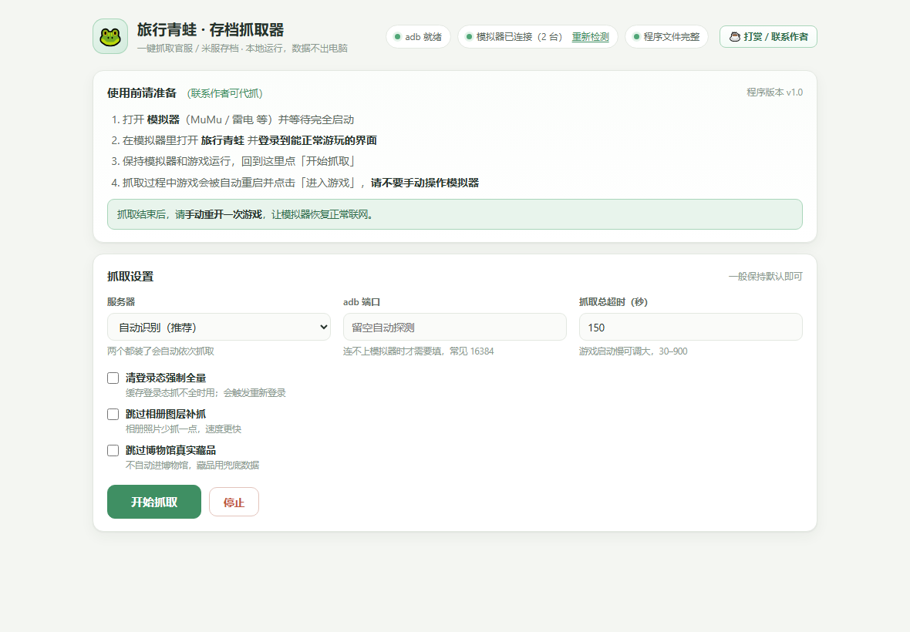

# 旅行青蛙 · 存档抓取器

> 本地运行的存档抓取工具：安卓模拟器 + adb + 本地 TLS 中间人代理，抓取官服 / 米服 / 华为 / OPPO / vivo / b站渠道服的登录协议，直接生成**可导入**的存档 json。
> 全部逻辑在本机跑，网页界面只监听 `127.0.0.1`，存档数据不上传任何服务器。



> ⚠️ **时间提醒**：官服 / 米服将于 **2026-12-08 18:00 停服并清空账号数据**，停服后无法再抓，请用前抓紧。

## 功能

- **一键抓取**：自动探测模拟器 adb 端口 → 装证书 → 起代理 → 重启游戏并点「进入游戏」→ 抓协议 → 生成存档
- **六服支持**：官服 `com.aligames.lxqw.hhb`、米服 `com.ali.croak.mi`、华为 `com.Aligames.lxqw.huawei`、OPPO `com.ali.croak.nearme.gamecenter`、vivo `com.ali.croak.vivo`（官方 2025-04-19 已停运）、b站 `com.ali.croak.bilibili`；装了几个就依次各抓一遍，也可 `--pkg` 指定
- **渠道账号 SDK 透传**（v2.4）：heytap / oppomobile / 小米 / 华为等账号域名原样转发不解密，开着抓取器也能正常登录进游戏；转发 socket 握手后解除超时，不再掐断长连接
- **登录页识别**（v2.1/v2.4）：自动勾协议、点「同意 / 进入游戏」；遇到「切换账号 / 其他账号登录」会停手等你手动登录，不再盲点跳过
- **证书装进 App 命名空间**（v2.0）：同时 bind mount 到 `shell`、`zygote`、`zygote64`，并按 MD5 + 证书总数校验，解决别人电脑上 `CERTIFICATE_UNKNOWN` / 0 协议
- **MuMu 虚拟显示**（v1.9）：识别「应用保活 / KeepAlive」分配的 display，截图与点击用正确的显示 id，不再黑屏误判
- **华为渠道服专项**：自动处理隐私协议 / 联运服务声明 / 启动页勾选；检测 HMS Core 与 CPU ABI；「一键退出华为账号」按账号库计数判定 + 软重启 zygote（v2.3 修复了此前永远清不掉的问题）
- **OPPO 退出账号**（v2.2）：游戏数据 → 外部存储 → 欢太账号中心逐层清理，页面列出每一步结果
- **收集项补全**：相册图层（含注入补抓）、博物馆真实藏品、省花图鉴、床边花瓶插花、庭院花盆与肥料格
- **博物馆按账号真实点亮**：抓完自动进「小仓库 → 博物馆」触发 `museum_load`，藏品只补这个号真正点亮的（其余保留问号），抓不到会明确标注「底稿兜底」
- **结果直用**：输出 `导入单机版_<昵称>_旅行青蛙存档_<时间>.json`，可直接导入单机版，或拖进存档编辑器查看修改
- **节日趣闻**（v1.2）：官服收到的贺卡写入存档顶层 `receivedCards`（v14 单机版原生认），兼容旧版 `greetCard.receivedList`
- **本地网页界面**：环境自检（adb / 模拟器 / 文件完整性）、一键恢复联网、渠道服退号按钮、实时日志、打赏与开源地址入口

## 版本与下载

所有版本的安装包都在 [Releases](../../releases) 里，点版本标签即可下载对应 zip。建议使用最新版。

> 资产文件名显示为 `_vX.Y_.zip`：GitHub 会把中文文件名规范化成这个形式，内容就是「旅行青蛙抓取器 vX.Y 安装包」，解压后的顶层文件夹仍是 `旅行青蛙抓取器_vX.Y/`。

| 版本 | 说明 | 安装包 |
| --- | --- | --- |
| v2.5 | 安装包结构整理：最外层只留 4 个文件，程序收进 `TravelFrogGrabber/`；补开源地址 | [v2.5](../../releases/tag/v2.5) |
| v2.4 | 修复 OPPO 开着抓取器进不去游戏：账号 SDK 透传 + 解除长连接超时 + 清理残留代理 | [v2.4](../../releases/tag/v2.4) |
| v2.3 | 华为账号真的能退掉：按账号库判定、软重启 zygote、adb 掉线自动重连 | [v2.3](../../releases/tag/v2.3) |
| v2.2 | 修复华为退号 `ValueError`；OPPO 登录信息逐层清理；渠道认证卡住诊断 | [v2.2](../../releases/tag/v2.2) |
| v2.1 | 渠道服卡启动页：自动勾协议、轮换进入按钮；虚拟显示坐标缩放 | [v2.1](../../releases/tag/v2.1) |
| v2.0 | 证书装进 zygote 命名空间；挂载后 MD5 + 证书数校验 | [v2.0](../../releases/tag/v2.0) |
| v1.9 | MuMu 应用保活虚拟显示识别，修复博物馆补采黑屏 | [v1.9](../../releases/tag/v1.9) |
| v1.8 | 全渠道稳定性：残留 iptables / 证书强制还原；x86 加固库自动修 ABI | [v1.8](../../releases/tag/v1.8) |
| v1.7 | 华为渠道服 x86 加固库闪退修复（armeabi-v7a 重装） | [v1.7](../../releases/tag/v1.7) |
| v1.6 | host-all 解密 + 证书自检，修复「几千条连接、解密 0 条」 | [v1.6](../../releases/tag/v1.6) |
| v1.5 | 界面补齐六服；新增 OPPO 退出账号按钮 | [v1.5](../../releases/tag/v1.5) |
| v1.4 | b站服修复；证书补 flysdk.cn / aligames.com | [v1.4](../../releases/tag/v1.4) |
| v1.3 | 内置 Python 换 3.8.10，兼容 Windows 7 | [v1.3](../../releases/tag/v1.3) |
| v1.2 | 节日趣闻按 v14 格式输出 `receivedCards` | [v1.2](../../releases/tag/v1.2) |
| v1.1 | 存档新命名、三服标注、覆盖安装修复 | [v1.1](../../releases/tag/v1.1) |
| v1.0 | 首个开放版本：三服抓取、华为渠道服、博物馆真实藏品 | [v1.0](../../releases/tag/v1.0) |

## 环境要求

| 项目 | 要求 |
| --- | --- |
| 系统 | Windows 7 / 10 / 11 **64 位**（内置 Python 3.8.10 便携版，Win7 可用） |
| 模拟器 | MuMu / 雷电等，需要能 `adb root`（改系统证书区、跨命名空间挂载） |
| 游戏 | 模拟器里已安装并**登录**到能正常游玩的界面 |
| 网络 | 首次运行允许防火墙放行本地 `8443`（代理）与 `8727`（界面） |

> ⚠️ **只支持安卓模拟器**：代理地址走模拟器网关 `10.0.2.2:8443`，USB 连接的实体手机不适用。

## 快速开始（推荐）

1. 到 [Releases](../../releases) 下载最新版 `_v2.5_.zip`（即「旅行青蛙抓取器 v2.5 安装包」；GitHub 会把中文资产名规范化成这个形式）
2. **完整解压**到任意目录，会看到：
   ```
   旅行青蛙抓取器_v2.5\
       安装.bat   卸载.bat   安装说明.txt   使用说明.md
       TravelFrogGrabber\      ← 程序本体
   ```
3. 双击最外层的 `安装.bat`；桌面和开始菜单会出现「旅行青蛙抓取器」
4. 双击打开，浏览器自动进入本地界面；按提示准备好模拟器与游戏，点「开始抓取」
5. 抓完请**手动重开一次游戏**恢复联网

渠道服（OPPO / vivo / b站）请**先在恢复联网状态下手动登录进庭院**，再开始抓取；抓取时不要勾「清登录态」。

抓取结果在程序目录的 `output/一键抓官服_<时间戳>/` 下，其中 `导入单机版_<昵称>_旅行青蛙存档_<时间>.json` 可直接导入单人版。

## 从源码运行

代码只依赖 Python 标准库（3.8+ 即可），没有任何第三方包。

```bash
# 1) 放好 adb：tools/platform-tools/adb.exe，或用环境变量 ADB 指定路径
# 2) 放好代理证书：tools/mitm/ca.pem、srv.pem、srv.key
#    这三个文件含本工具专用的自签 CA 私钥，仓库不收录（见 .gitignore），
#    请从 Release 安装包中复制，避免私钥被公开滥用
python app.py          # 默认 http://127.0.0.1:8727/ ，被占用会自动顺延
```

Windows 下也可以用 `launch.vbs` 隐窗启动（日志写到 `logs/app.log`）。

## 目录结构

```
app.py                      本地网页服务（标准库 http.server）+ 任务调度
web/index.html              单页界面（进度、日志、结果、打赏与开源入口）
scripts/grab_official.py    抓取主流程：adb、代理、证书、重启游戏、落盘
scripts/cert_install.py     跨 shell / zygote 命名空间安装与校验 CA
scripts/game_display.py     MuMu 虚拟显示识别、截图与点击
scripts/game_boot.py        启动页 / 登录页识别与自动过页
scripts/net_restore.py      环境自检与一键恢复联网
scripts/grab_diag.py        抓空诊断
scripts/huawei_channel.py   华为：状态查询 / 退号 / HMS / 修 ABI / 过协议页
scripts/oppo_channel.py     OPPO：账号与数据逐层清理
scripts/生成实号存档.py      协议 → 存档 json（加密封装）
scripts/转换_官服家具.py     家具/博物馆配置转换
scripts/补救_从抓包提取相册图层.py  已抓完但照片空白时的离线补救
tools/mitm/ws_proxy.py      TLS 中间人代理（纯标准库实现）
tools/mitm/parse_ws.py      协议解析
lib/tf.py                   存档加解密（信封 format/version/salt/data/checksum）
data/config_json/           家具、博物馆等配置（转换用）
```

## 渠道服的几个坑

| 坑 | 现象 | 工具怎么处理 |
| --- | --- | --- |
| 阿里聚安全加固 x86 库 | 华为服启动 6 秒 `SIGSEGV`，崩溃栈全是 `libsgmainso` | 检测 `primaryCpuAbi`，非 ARM 时以 `armeabi-v7a` 重装（走 houdini 转译） |
| 强依赖 HMS Core | 卡在「安装 HMS Core」提示，取消→二次确认→再弹出 | 自动检测并安装 `tools/apk/hmscore.apk` |
| 多道协议页 / 启动页 | 隐私协议 → 联运声明 →「我已阅读并同意」 | 按界面类型自动点击，坐标按分辨率等比换算 |
| Android 10+ 应用独立 mount namespace | 只在 `adb shell` 挂 CA，游戏报 `CERTIFICATE_UNKNOWN`、抓 0 协议 | 同时挂进 zygote/zygote64，校验目标命名空间里 CA 的 MD5 与证书总数 |
| MuMu 应用保活 | 游戏跑到虚拟 display，截屏黑屏 / 点击无效 | 现查 display，逻辑 id 给 `input -d`，物理 id 给 `screencap -d` |
| 渠道账号 SDK TLS | 开着抓取器游戏永远停在「正在读取中」 | heytap / oppomobile / 小米 / 华为等域名原样透传；转发 socket 握手后不设超时 |
| 登录页要求换号 | 抓取器盲点「进入游戏」跳过登录 | 识别「切换账号 / 其他账号登录 / 手机号登录」后停手，等人工登录 |

**账号相关**

- 华为账号登录页设了 `FLAG_SECURE`，**截屏返回 0 字节**，账号密码只能自己在模拟器里输入，工具不会代填、也不记录
- 华为换号点「一键退出华为账号」：删 `/data/system_de`、`/data/system_ce` 的 `accounts*.db`，**按库计数判定成功后软重启 zygote**（v2.3 起不再用 `dumpsys` 的内存缓存误判失败）；`pm clear com.huawei.hwid` 没用
- OPPO 换号点「退出 OPPO 账号」：游戏数据 → `/sdcard/Android/data/<包名>` → 欢太账号中心逐层清理
- 退号不影响服务器存档，但游戏下次启动要重新登录
- 验证华为账号是否退干净：`adb shell dumpsys account | grep "Accounts:"`，`Accounts: 0` 才算干净

**为什么新账号进不去**

服务器自 2026-09-08 起停止新用户注册，登录时报 `P_-10112`（subCode `5002007`）就是「这个账号在本渠道没有历史角色，且不允许注册」。
只有 **2026-09-08 之前在该渠道玩过**的账号能进——那走的是老玩家登录，不是注册。

## 换一台电脑能用吗？

**能，但要满足上面的环境要求。** 安装包是自包含的：Python 运行时、adb、代理脚本、证书、配置数据全在目录里，不依赖其他盘符或已安装的 Python。

已在「中文目录名 + 目录带空格 + 换盘符 + 清空 `ADB`/`PYTHONPATH`/`PYTHONHOME` 环境变量」的条件下实测：界面服务、静态资源、adb 探测、`tools/mitm` 与 adb 的自定位、证书文件校验全部正常。

可能踩的坑：

- **端口 8443 被占用**：代理起不来；新任务启动前会自动清残留代理，仍占用时会明确提示
- **防火墙弹窗**：代理要监听 `8443` 才能被模拟器访问，选「允许访问」（专用网络即可）
- **模拟器没 root**：证书推不进系统证书区，抓不到 https，换 MuMu / 雷电并开启 root
- **公司/学校电脑**：安全软件可能拦截 `adb.exe`、写系统分区或注册表，装不上就别硬来
- **ARM 版 Windows**：未测试（Python 便携版是 x64）

## 免责声明

- 本工具**仅用于备份自己账号的存档**，以及自己账号的设备迁移、数据恢复。
- 请勿用于破解、倒卖账号、侵犯他人数据或任何违反游戏用户协议与当地法律的用途。
- **严禁**用本工具或抓出来的存档**高收费牟利**、批量倒卖、包装成付费服务出售。
- 《旅行青蛙》游戏本体、素材、协议与数据的版权归原权利人所有；本仓库只包含作者原创的代码与文档。

## 打赏 / 联系方式

- 界面右上角「打赏 / 联系作者」中有支付宝收款码，打赏金额随意，全凭自愿
- QQ：**203147001**（不会操作、模拟器连不上、抓取失败都可以问）
- 也可**有偿代抓取存档：5 元/次**，加好友备注「抓存档」
- 再次强调：**严禁**拿本工具高收费牟利

## 许可协议

本项目采用 **[CC BY-NC-SA 4.0](LICENSE)**（署名—非商业性使用—相同方式共享 4.0 国际）许可：

- ✅ 可以自由使用、修改、fork、二次开发
- ✅ 修改后可以分发，但**必须继续开源**（相同方式共享），并保留署名
- ❌ **不得用于商业用途**：不能卖、不能收费分发、不能拿它做收费代抓服务
- 想商用请先联系作者单独授权

> 说明：GPL / AGPL 虽然也强制开源，但**允许收费**，不符合"不能收费"的要求，所以这里选了带 NonCommercial 的 CC 协议。
